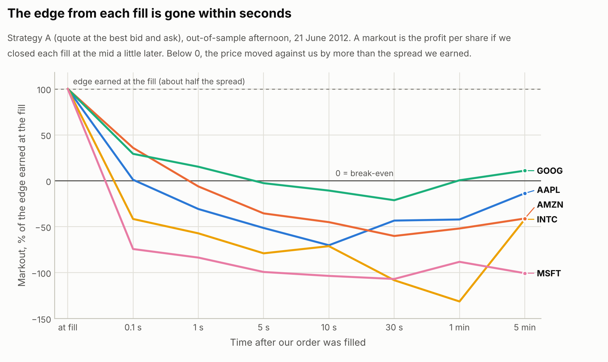
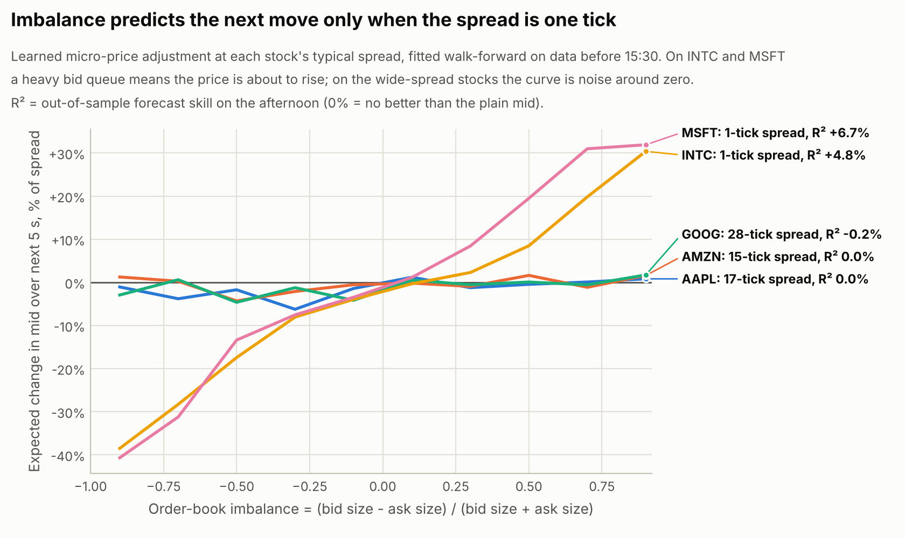
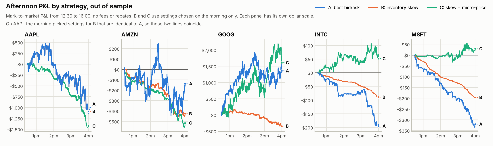
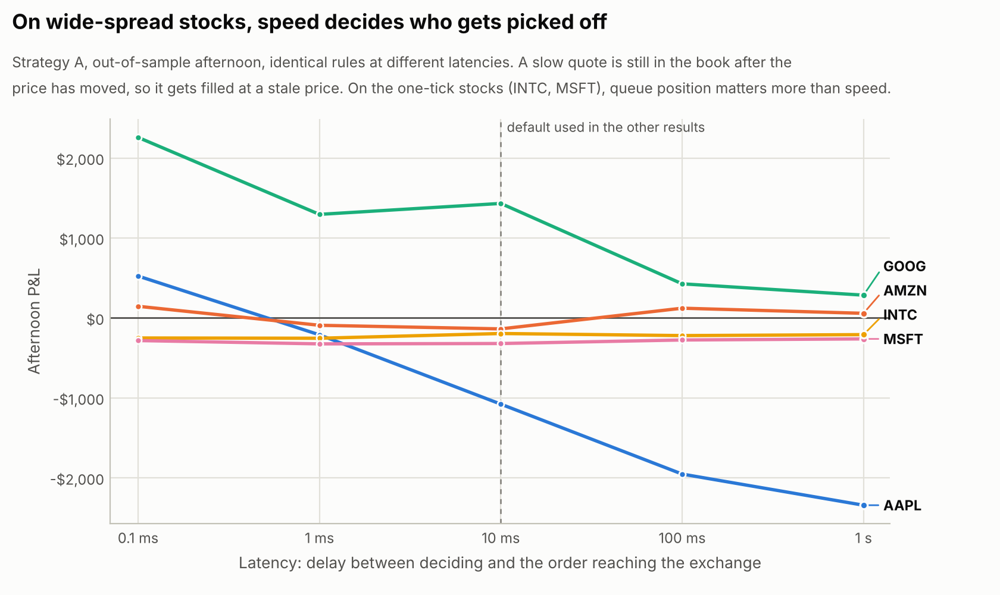
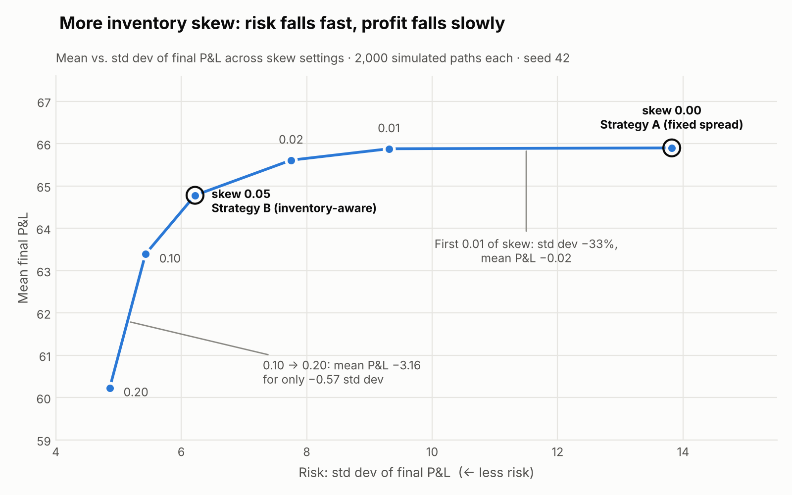

# Market Making: From Simulation to Real Order-Book Data

Two experiments on the same question: **how should a market maker quote, and does it make money?**

- **Part 1, simulation.** A random-walk market where fills are random. Inventory-aware quoting
  cut P&L volatility by 55% while giving up only 1.7% of mean profit. But in that model nobody
  trading with you knows anything.
- **Part 2, real data.** An event-driven backtester that replays **2.1 million real Nasdaq
  order-book messages** (AAPL, AMZN, GOOG, INTC, MSFT, 21 June 2012), with FIFO queue position,
  latency and post-only orders. It measures what the simulation left out: **adverse selection**.

## Part 2 in five findings

Unless noted, numbers are from the out-of-sample afternoon (12:30–16:00), using settings chosen
on the morning only.

1. **The edge from each fill is gone within seconds.** The half-spread a market maker earns when
   filled had turned into a loss within 5 seconds on all five stocks, and within 0.1 seconds on
   INTC and MSFT. Five seconds after an MSFT fill, the average trade was down as much as it had
   earned at the fill.
2. **Simply joining the best bid and ask loses money.** It lost in all five mornings and four of
   five afternoons. To break even it would have needed an exchange rebate of 0.31–0.75¢ per share,
   more than 2012 rebate schedules paid ([e.g. NSX, $0.0024–$0.0029](https://www.govinfo.gov/content/pkg/FR-2012-05-16/pdf/2012-11793.pdf)).
3. **On wide-spread stocks, speed decides who gets picked off.** On AAPL the same strategy went
   from **+$524 at 0.1 ms** latency to **−$1,078 at 10 ms** and −$2,342 at 1 second. On the
   one-tick stocks latency barely mattered; queue position did.
4. **Order-book imbalance predicts prices only where theory says it should.** A walk-forward
   micro-price forecast the next 5 seconds out of sample on the one-tick stocks
   (R² +4.8% INTC, +6.7% MSFT) and not at all on the wide-spread ones (≈0%), where the naive
   "weighted mid" was far worse than no forecast (R² −31% to −85%).
5. **The micro-price turned significant losses into break-even on INTC and MSFT, mostly by
   trading less.** Strategy C beat A on both (95% confidence intervals above zero) while trading
   about 90% fewer shares. Its per-fill markouts were no better: the gain came from knowing when
   *not* to quote.









## Part 2: How it works

### The data

[LOBSTER](https://lobsterdata.com) rebuilds the Nasdaq limit order book from the exchange's own
message feed. Its free sample day has every order event (new orders, cancellations, executions,
each with an order ID, nanosecond timestamp, price and size) plus the best bid and ask after each
event.

| Stock | Messages | Typical spread | Shares at the best bid (median) |
|---|---:|---:|---:|
| AAPL | 400,391 | 15 ticks | 100 |
| AMZN | 269,748 | 13 ticks | 100 |
| GOOG | 147,916 | 28 ticks | 100 |
| INTC | 624,040 | 1 tick | 13,391 |
| MSFT | 668,765 | 1 tick | 12,030 |

These are two different worlds. On AAPL, AMZN and GOOG the spread is wide and the queue at the
best price is tiny. On INTC and MSFT the spread is pinned at one cent and over 12,000 shares wait
in line at the best price.

`python run_lob.py --download` fetches a compact copy of the sample (all messages plus best bid
and ask) published in the GitHub project
[m4rpg/algo-trading-liquidity](https://github.com/m4rpg/algo-trading-liquidity). I checked the AAPL
file row-for-row against the official LOBSTER message file. The loader also reads the official
LOBSTER files directly.

### The backtester (`lob/engine.py`)

We replay the day message by message and pretend we also had orders in the book:

- **FIFO queue position.** When our order joins a price level it goes to the back of the queue.
  Shares ahead of us leave the queue when they trade or are cancelled. Orders that arrive after us
  are behind us, identified by their order IDs, so their cancellations don't move us up.
- **Three ways to be filled:** trades at our price after the queue ahead is used up; trades at a
  *worse* price than ours (we would have been hit first); and new orders that cross our price.
- **Latency.** Every order and cancel takes 10 ms to reach the exchange (varied from 0.1 ms to 1 s
  in the latency test). A cancel in flight can't stop a fill that happens first.
- **Post-only.** New orders that would cross the spread are rejected, and we only place new orders
  at or inside the best price, where the queue ahead is known from the data.

### The three strategies (`lob/strategies.py`)

All three use the same rule as Part 1's Strategy B: quote around a reservation price,
`fair value − skew × inventory`, at `theta × half-spread` on each side, with a 500-share
position limit.

| | Fair value | Settings |
|---|---|---|
| **A: best bid/ask** | mid | theta = 1, skew = 0: always join the best bid and ask |
| **B: inventory skew** | mid | theta and skew chosen on the morning |
| **C: skew + micro-price** | mid + micro-price adjustment | theta and skew chosen on the morning |

The **micro-price** (`lob/signal.py`), after Stoikov (2018), learns the average change in the mid
over the next 5 seconds for each bucket of order-book imbalance and spread.

### How we avoided fooling ourselves

- **Calibrate on the morning, test on the afternoon.** For B and C, 20 combinations of theta and
  skew were tried on 09:30–12:30. The best one was then run once on 12:30–16:00.
- **Walk-forward fitting with purging.** The micro-price used in each 30-minute fold is fitted only
  on earlier folds. Training samples whose 5-second label would reach into the next fold are
  dropped, so not even a label leaks across the boundary. A test checks that scrambling the
  afternoon leaves the morning's model unchanged.
- **Confidence intervals, not single numbers.** P&L is compared in 5-minute intervals, with a
  block bootstrap (resampling 15-minute blocks to respect autocorrelation). Strategies are compared
  *paired*, on the same intervals.
- **10 automated tests** cover queue priority, cancels ahead of and behind us, trade-through fills,
  latency, in-flight cancels, post-only rejection, the position limit and the P&L identity.

### Results (afternoon, out of sample, no fees or rebates)

| Stock | A: best bid/ask | B: inventory skew | C: skew + micro-price | C − A per 5 min (95% CI) |
|---|---:|---:|---:|---|
| AAPL | −$1,078 | −$1,078 | −$1,426 | −$8.3 (−43.9 to +20.3) |
| AMZN | −$137 | −$427 | −$510 | −$8.9 (−29.9 to +12.4) |
| GOOG | +$1,432 | −$334 | +$1,690 | +$6.2 (−33.9 to +70.9) |
| INTC | −$195 | −$89 | +$52 | **+$5.9 (+1.0 to +12.3)** |
| MSFT | −$320 | −$196 | +$29 | **+$8.3 (+4.7 to +11.4)** |

On AAPL the morning picked settings for B identical to A, so their results match. Losses for A
on INTC and MSFT are statistically significant; GOOG's afternoon profit is not (its 95% interval
includes zero, and A lost $1,764 on GOOG that morning). Every number, plus the full calibration
grid, markouts and latency sweep, is in [`results/`](results/).

**Part 1's fill model, measured.** Part 1 assumed fills decay as `A · exp(−k · distance)`. Fitted
to real market orders, that shape holds well on the wide-spread stocks (R² 0.98–0.99, with
k = 16–34 per dollar) but describes nothing on the one-tick stocks, where almost every market
order stops at the best price. See [`results/fill_intensity.png`](results/fill_intensity.png).

### Limitations

- **A replay can't react to us.** Our orders aren't in the historical data, so other traders
  never respond to them, and a trade that fills us still fills the historical orders too.
- **One day.** One trading day per stock from 2012, so the intervals are wide and market structure
  has changed since. The design matters more than the exact numbers.
- **Best level only.** The data give the best bid and ask, so we never place orders deeper in the
  book, where we wouldn't know our queue position.
- **Simplified economics.** No fees or rebates inside the P&L (a column in `results/` adds a
  0.20¢ rebate), no hidden-order priority, and positions are marked at the mid, not closed out.

### How to run

```bash
pip install -r requirements.txt
python run_lob.py --download   # first time: fetch the sample data (~25 MB) into data/
python run_lob.py              # calibrate, test and write results/ (about 1.5 minutes)
python -m pytest tests -q      # the 10 engine and signal tests
```

### Files

| File | What it does |
|---|---|
| `run_lob.py` | The whole Part 2 experiment: calibration, out-of-sample test, latency sweep, results. |
| `lob/data.py` | Loads LOBSTER messages and the best bid and ask into numpy arrays. |
| `lob/engine.py` | The backtester: our orders, queue position, latency, fills and P&L. |
| `lob/strategies.py` | Strategies A, B and C. |
| `lob/signal.py` | Order-book imbalance, the walk-forward micro-price and out-of-sample R². |
| `lob/calibrate.py` | Fits the `A · exp(−k · distance)` fill model to real market orders. |
| `lob/analysis.py` | Markouts, P&L per interval and block-bootstrap confidence intervals. |
| `lob/plots.py` | The charts in `results/`. |
| `tests/test_engine.py` | Hand-built order books with known answers for each fill rule. |

### References

- Avellaneda, M. & Stoikov, S. (2008). High-frequency trading in a limit order book. *Quantitative Finance*.
- Stoikov, S. (2018). The micro-price: a high-frequency estimator of future prices. *Quantitative Finance*.
- Huang, R. & Polak, T. (2011). LOBSTER: Limit Order Book Reconstruction System. lobsterdata.com.

---

## Part 1: Simulation

A small Python simulator of a market maker: someone who constantly offers to buy
slightly below fair value and sell slightly above it, earning the gap. It
simulates a random-walk price, quotes bids and asks around it, fills those quotes
at random (more often when they're attractive), and tracks cash, inventory and
mark-to-market P&L. It then compares two quoting strategies over thousands of
simulated markets.

**Research question:** does inventory-aware quoting reduce inventory risk without
sacrificing too much expected profit?

**Short answer (details below):** yes. In this model it cut the standard deviation
of P&L by 55% and the largest typical position by more than half, while giving up
only about 1.7% of average profit.



*Each point is one skew setting, run over the same 2,000 simulated markets. The
numbers come from the skew sweep table in the Results section.*

### How to run

```bash
git clone https://github.com/etavacoli/Market-Maker.git
cd Market-Maker
python -m venv .venv && source .venv/bin/activate
pip install -r requirements.txt
python experiment.py
```

It takes a few seconds. The seed is fixed (`SEED = 42` in `experiment.py`), so
you get exactly the same numbers every time. Change the seed to see a different
set of random markets.

### Files

| File | What it does |
|---|---|
| `market.py` | The market. `price_action()` moves the mid price as a random walk; `fill_probability()` decides how likely a quote is to get filled. |
| `strategy.py` | The two quoting strategies: `FixedSpreadMaker` (A) and `InventoryAwareMaker` (B). |
| `simulator.py` | Runs one strategy over one price path, step by step, tracking cash, inventory and P&L. |
| `metrics.py` | Turns simulation results into numbers (mean P&L, worst loss, max inventory, ...) and prints the comparison table. |
| `experiment.py` | All the settings, plus the experiment itself: thousands of paths per strategy, the worst-path replay and the skew sweep. |

`price_action()` comes from an earlier stage of this project. The only change is
one optional `rng` argument (marked `[Added]` in the code): passing a seeded
generator makes the price path reproducible, and leaving it out (`rng=None`)
behaves exactly like the original.

---

### The concepts, in plain language

#### 1. Random walk (the mid price)

The "mid" is the market's current idea of fair value. Each step, it moves by a
random amount:

    P(t+1) = P(t) + eps,    eps ~ Normal(0, sigma^2)

Each move is independent of the last one, so knowing the past doesn't help you
predict the next move. On average the price goes nowhere (mean 0), but over time
it can wander far from where it started. Here sigma is about 0.14 per step, so a
200-step path typically ends within about +/-2 of 100, though some go further.

#### 2. Bid, ask and spread

A market maker posts two prices at once:

- **Bid**: the price it will buy at (below the mid).
- **Ask**: the price it will sell at (above the mid).
- **Spread**: the gap between them. **Half-spread** is the distance from the mid to either side.

With mid = 100 and half-spread 0.50: bid 99.50, ask 100.50. If someone sells to
us at 99.50 and someone else buys from us at 100.50, we've made 1.00 without
having any opinion on where the price is going. That's the business.

#### 3. Fill probability: why attractive quotes fill more

Nobody is forced to trade with us. A seller would happily take a bid of 99.99 when
fair value is 100, but a bid of 95 is a bad deal. So the further our quote is from
the mid, the less likely anyone takes it. We model that as:

    P(fill in one step) = A * e^(-k * delta)

- **delta** is how far the quote is from the mid (0.50 for our default quotes).
- **A** is the fill chance for a quote right at the mid (0.7 here).
- **k** is how price-sensitive other traders are (1.5 here). Each extra dollar of
  distance multiplies the fill chance by e^(-k). With k = 1.5, each extra 10 cents
  cuts it by about 14%.

With delta = 0.50, P(fill) = 0.7 x e^(-0.75) ≈ 0.33 per side per step.

This captures the market maker's core trade-off: **wide quotes earn more per trade
but trade less; tight quotes trade more but earn less each time.** The bid and
the ask are checked separately each step, so a step can have 0, 1 or 2 fills.

#### 4. Inventory and cash

**Inventory** is how many shares we hold: positive means long, negative means short.
**Cash** is money in or out. Each fill is one share:

- **Bid fill** (someone sells to us): `inventory += 1`, `cash -= bid`
- **Ask fill** (someone buys from us): `inventory -= 1`, `cash += ask`

We start with 0 cash and 0 shares. Cash goes negative after a buy; that's fine,
because we own the share instead.

#### 5. Mark-to-market P&L

Cash alone is misleading: after buying a share our cash is -99.50, but we own
something worth about 100. **Mark-to-market** values everything we hold at the
current mid:

    P&L = cash + inventory * mid

Worked example:

1. Mid 100, our bid at 99.50 fills: inventory 1, cash -99.50, P&L = -99.50 + 1 x 100 = **+0.50**.
2. If our ask at 100.50 fills next (mid still 100): inventory 0, cash +1.00, P&L = **+1.00**.
3. If instead the price drops to 98 before we sell: P&L = -99.50 + 1 x 98 = **-1.50**.

The simulator also splits P&L into two parts, which is the key to understanding
the results:

- **Spread P&L**: the edge earned on each fill, measured from the mid at the time of
  the trade (buying at 99.50 when the mid is 100 earns 0.50). This is what the
  market maker is paid for providing liquidity.
- **Inventory P&L**: everything else, i.e. gains or losses from the price moving
  while we hold a position.

**Total P&L = spread P&L + inventory P&L**, exactly.

#### 6. Inventory risk

Fills are random, so a fixed-spread maker can get hit on the bid several times in a
row and end up holding +20 shares without choosing to. Now every 1.00 drop in the
price costs 20. In this model the price has no trend, so on average inventory P&L
is about zero. **Inventory adds risk but no expected return.** It just makes results
noisier and occasionally very bad. That's inventory risk: exposure to directional
moves you never meant to bet on.

#### 7. Reservation price (the inventory-aware fix)

Strategy B centres its quotes on a **reservation price** instead of the mid. The
reservation price is the price it would be happy to trade at, given what it already
holds:

    reservation = mid - skew * inventory
    bid = reservation - half_spread
    ask = reservation + half_spread

- **Long** (inventory > 0): both quotes shift down. The bid moves further from the mid,
  so buying more is less likely. The ask moves closer, so selling is more likely.
  Inventory drifts back toward 0.
- **Short**: both quotes shift up, so it's more likely to buy back.
- **Flat**: identical to Strategy A.

With skew = 0.05, holding +10 shares moves both quotes down by 0.50: bid 99.00,
ask 100.00 when the mid is 100. In effect B is saying "I'll give up a little edge
to get rid of a position I don't want."

---

### Experiment setup

| Setting | Value | Meaning |
|---|---|---|
| Paths | 2,000 per strategy | independent simulated markets |
| Steps per path | 200 | |
| Start price | 100 | |
| sigma per step | ~0.141 | 2 x sqrt(0.005) |
| A (fill prob at mid) | 0.7 | 140 x 0.005 |
| k | 1.5 | |
| Half-spread | 0.50 | both strategies |
| Skew (Strategy B) | 0.05 per share | |
| Seed | 42 | |

The market parameters (sigma = 2 per unit time, dt = 0.005, A = 140, k = 1.5) are
taken from Avellaneda & Stoikov (2008), *High-frequency trading in a limit order
book*, a classic market-making paper. That makes the setup comparable to a known
benchmark.

**Fair comparison:** both strategies see the **same 2,000 price paths and the same
random numbers for fills**. Any difference in results comes from how they quote,
not from one getting luckier. (Check: with skew = 0, Strategy B's numbers match
Strategy A's exactly.)

### Results

#### 1) Strategy comparison (2,000 paths each)

| Metric | A: fixed spread | B: inventory-aware (skew 0.05) |
|---|---:|---:|
| Mean final P&L | 65.90 | 64.78 |
| Std dev of final P&L | 13.82 | **6.22** |
| Worst final P&L | -5.25 | **43.97** |
| Sharpe-like (mean / std) | 4.77 | **10.41** |
| Mean spread P&L | 66.19 | 64.83 |
| Mean inventory P&L | -0.29 | -0.05 |
| Std dev of inventory P&L | 12.95 | **4.12** |
| Avg fills per path | 132.39 | 133.94 |
| Avg max \|inventory\| | 11.20 | **5.01** |
| Worst max \|inventory\| | 34 | **9** |
| Avg \|inventory\| | 4.95 | 1.59 |

("Avg |inventory|" averages the size of the position over each path. It uses
absolute values because +10 and -10 would otherwise cancel to a misleading 0.)

What it shows:

- **Almost all of the profit comes from the spread**, for both strategies (about 65
  out of about 65). Mean inventory P&L is about 0, as expected with a trendless price.
- **Almost all of the risk comes from inventory.** For A, the inventory P&L std dev
  (12.95) is nearly the whole P&L std dev (13.82).
- **B cuts that risk sharply:** P&L std dev down 55%, average largest position down
  from 11 to 5 shares, worst position from 34 to 9.
- **The cost is small:** mean P&L falls by 1.12 (1.7%). Skewing makes one side tighter
  than 0.50 at times, so those fills earn less edge. B actually trades slightly
  more, but earns a little less per trade.
- **Tail outcomes improve the most:** A's worst path lost money (-5.25). B's worst
  path still made 43.97.

#### 2) Inventory risk up close: Strategy A's worst path

On path #65 the price slid from 100 to about 95.4. Strategy A kept buying on the
way down and built up as many as +24 shares; Strategy B never held more than 6.
(The script prints every 20th step; a selection is shown here.)

| step | mid | A inventory | A P&L | B inventory | B P&L |
|---:|---:|---:|---:|---:|---:|
| 0 | 100.00 | 0 | 0.00 | 0 | 0.00 |
| 40 | 100.37 | 9 | 14.41 | 3 | 14.10 |
| 100 | 98.55 | 12 | 21.25 | 4 | 32.42 |
| 140 | 97.24 | 21 | 16.64 | 4 | 42.88 |
| 160 | 95.82 | 20 | -7.22 | 0 | 46.74 |
| 200 | 95.36 | 21 | -5.25 | -1 | 57.10 |

    A: spread P&L 69.50  +  inventory P&L -74.75  =  total -5.25
    B: spread P&L 69.90  +  inventory P&L -12.80  =  total 57.10

Both earned about the same from the spread. A gave all of it back, and more, by
holding a large long position into a falling market. That's inventory risk in one picture.

#### 3) Skew sweep: how much skew?

The chart at the top of this README plots this table.

| skew | mean P&L | std P&L | worst P&L | Sharpe-like | avg max \|inv\| |
|---:|---:|---:|---:|---:|---:|
| 0.00 (= A) | 65.90 | 13.82 | -5.25 | 4.77 | 11.20 |
| 0.01 | 65.88 | 9.31 | 30.03 | 7.08 | 8.06 |
| 0.02 | 65.61 | 7.75 | 37.15 | 8.47 | 6.74 |
| 0.05 | 64.78 | 6.22 | 43.97 | 10.41 | 5.01 |
| 0.10 | 63.39 | 5.43 | 44.58 | 11.68 | 3.85 |
| 0.20 | 60.23 | 4.86 | 44.33 | 12.39 | 2.88 |

- **The first bit of skew is almost free:** 0.01 cuts std dev by a third and costs 0.02 of mean P&L.
- **Returns diminish:** going from 0.10 to 0.20 costs 3.16 of mean P&L but only reduces std dev by 0.57.
- With large skews the maker sometimes quotes on the wrong side of the mid. For
  example, with skew 0.20 and +3 shares, the ask is 0.10 *below* the mid. It is
  effectively paying to get flat.
- Which skew is "best" depends on how much you dislike risk. Sharpe-like keeps
  rising here, but mean profit keeps falling.

#### Answer to the research question

**Yes.** In this model, inventory-aware quoting dramatically reduces inventory
risk for a small cost in expected profit. With skew 0.05: about half the P&L
volatility, less than half the typical position, no losing paths, and only 1.7%
less average profit. The reason is that inventory risk is *uncompensated* here:
holding a position adds variance but no expected return. So getting rid of it is
cheap, and you only pay a little edge to do so.

### Limitations and possible next steps

- **No adverse selection.** (Part 2 measures it on real data.) Fills here are independent of where the price goes next.
  In real markets, the trader hitting your bid often knows something (they sell
  just before a drop). That makes inventory more dangerous and spreads more important.
- **Constant skew.** Avellaneda-Stoikov uses `reservation = mid - q * gamma * sigma^2 * (T - t)`.
  The skew depends on risk aversion (gamma), volatility, and time left, and the paper
  also derives an optimal spread. That's the natural next upgrade.
- **Fixed half-spread.** Both strategies always quote 0.50. Optimising the spread
  (e.g. widening when volatility is high) is another lever.
- **No hard inventory limits, fees, latency, or order sizes beyond 1 share.**
- **More charts.** The skew sweep is plotted above. Inventory and P&L paths and a
  P&L histogram per strategy would make the head-to-head comparison easier to see.
